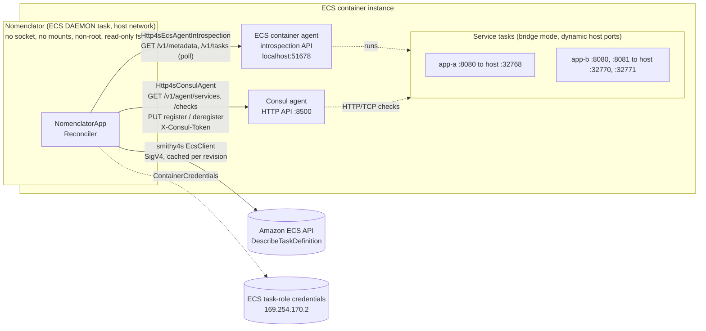
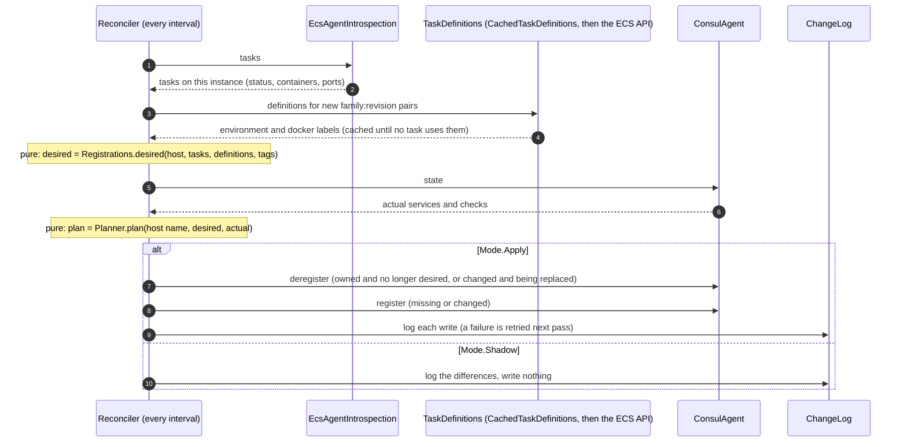

# Nomenclator

Nomenclator keeps a Consul agent's service catalog in step with the containers running on an Amazon ECS host. It reads the ECS agent's introspection endpoints and the task definitions' registration settings, then registers, updates, and deregisters Consul services so the catalog matches what is actually running.

Run `scripts/check` to format-check, compile under fatal warnings, and run every test. It runs `sbt check` and writes the full output to `target/check.log`, printing that path if the check fails.

## How it works



Nomenclator runs as an ECS **DAEMON** service in **host** network mode, one task per container instance. Host
networking is what lets it reach the ECS agent's introspection API and the Consul agent on loopback. It needs no
volume, no Docker socket, and no capabilities.



- **Desired, owned, and changed.** Desired is every registration the running tasks call for. Owned means a service on
  this agent whose ID starts with this host's name, which is how Nomenclator recognizes its own registrations and
  never touches anything else on the agent. Changed means the registration Nomenclator would send differs from what
  the agent reports, so unchanged services are never re-registered and a no-op never resets a check's state.
- **Each pass plans, then acts.** A pass reads the tasks and the agent, computes the desired and actual sets with pure
  functions, and writes only the difference. One failed write is logged and retried on the next pass; it never stops
  the others.
- **Shutdown does not deregister.** On `SIGTERM` Nomenclator stops its loop and exits, leaving every registration in
  place. Redeploying it must not drop every service on the host, and the next task recognizes the registrations as its
  own by the host-name prefix and reconciles from there.

## Configuration

Nomenclator reads environment variables. Durations use Go's syntax (`5s`, `1m30s`, `500ms`).

| Variable | Default | Meaning |
|---|---|---|
| `NOMENCLATOR_MODE` | `shadow` | `apply` writes to Consul; `shadow` only logs how Consul differs. |
| `CONSUL_HTTP_ADDR` | `127.0.0.1:8500` | The local Consul agent; plain HTTP unless a scheme is given. |
| `CONSUL_HTTP_TOKEN` | none | ACL token. Never logged. |
| `NOMENCLATOR_INTERVAL` | `5s` | Time between reconcile passes. At most the pass timeout. |
| `NOMENCLATOR_PASS_TIMEOUT` | `30s` | A pass still running after this fails. At least three and a half times the lookup timeout (the lookup phase's deadline, two and a half times it, plus one for the rest of the pass), less than the failure limit. |
| `NOMENCLATOR_LOOKUP_TIMEOUT` | `5s` | Bound on each task definition lookup. |
| `NOMENCLATOR_FAILURE_LIMIT` | `2m` | Exit non-zero after this long without a successful pass. |
| `NOMENCLATOR_TAGS` | none | Tags added to every service, comma-separated, kept exactly as written. |
| `NOMENCLATOR_HOSTNAME` | the host's name | The name that starts every service ID. |
| `NOMENCLATOR_ADDRESS` | the Consul agent's advertised address | The address registered for every service. |
| `NOMENCLATOR_ECS_AGENT_URL` | `http://localhost:51678` | The ECS agent's introspection API. |
| `AWS_REGION` | the region in the container instance's ARN | Region of the ECS API. |
| `AWS_CONTAINER_CREDENTIALS_RELATIVE_URI` | set by ECS | Task-role credentials. Required unless the full URI is set. |
| `AWS_CONTAINER_CREDENTIALS_FULL_URI` | none | A credentials endpoint elsewhere: `https`, or `http` only to a loopback address, `169.254.170.2`, `169.254.170.23`, or `fd00:ec2::23`. No authorization token is sent. |
| `AWS_ENDPOINT_URL_ECS` | the regional endpoint | Sends ECS API calls elsewhere. Scheme, host, and port only; a path is refused. |

The first command-line argument names the deployment environment (`Local`, `DevInt`, `Uat`, `Prod`, `Sandbox`, or
`Admin`); without one, Nomenclator uses `Local` and logs a warning. The standard `OTEL_*` variables configure
telemetry. On `SIGTERM`, Nomenclator stops without deregistering anything.

## Smoke test

This runs the real application on a workstation against a local Consul agent, a fake ECS agent serving the
introspection fixtures, and fake AWS endpoints. Nothing touches AWS; the credentials are made up.

1. Start a dev Consul agent and note its port:

   ```sh
   docker run -d --name nomenclator-smoke-consul -p 0:8500 hashicorp/consul:1.21 agent -dev -client 0.0.0.0
   docker port nomenclator-smoke-consul 8500
   ```

2. In another terminal, start the fakes. They print the variables that point Nomenclator at them, and run until
   stopped with Ctrl-C:

   ```sh
   sbt "integration/Test/runMain com.dwolla.nomenclator.integration.SmokeEnvironment"
   ```

3. In a third terminal, paste the printed `export` lines, then run in shadow mode. Replace `<port>` with Consul's
   port from step 1:

   ```sh
   export CONSUL_HTTP_ADDR=127.0.0.1:<port> NOMENCLATOR_HOSTNAME=smoke-host
   export OTEL_TRACES_EXPORTER=none OTEL_METRICS_EXPORTER=none
   NOMENCLATOR_MODE=shadow sbt "app/run Local"
   ```

   Expected: JSON log lines, starting with `Nomenclator is starting` and the effective configuration, then
   `Discovered this host's identity and region`, then a `Shadow difference appeared` line (`missing`) for each of the fixture's three services. Consul stays empty:
   `curl -s 127.0.0.1:<port>/v1/agent/services` prints `{}`. Stop it with Ctrl-C; it logs `Stopping as asked`.

4. Run in apply mode:

   ```sh
   NOMENCLATOR_MODE=apply sbt "app/run Local"
   ```

   Expected: a `Consul agent change: register` line for each service, and the three `smoke-host:` services in
   `curl -s 127.0.0.1:<port>/v1/agent/services`. After Ctrl-C they are still there.

5. Clean up: stop the fakes with Ctrl-C, then `docker rm -f nomenclator-smoke-consul`.

## Container image

The image holds one mostly static native executable (glibc from the base image), `/app/nomenclator`, with the JDK
library it loads beside it (`/app/libmanagement_ext.so`), on a distroless `base-debian12:nonroot` base. It is built with
Mandrel (GraalVM's native-image) by sbt-native-packager, so it has no JVM and no shell. The native-image flags live in
`app/src/main/resources/META-INF/native-image/com.dwolla/nomenclator/native-image.properties`, and the reflection
and resource metadata the executable needs lives next to them in `generated/`.

### Runtime requirements

The image is tested, and meant to run, as ECS runs it:

- the command is the deployment environment (`Local`, `DevInt`, `Uat`, `Prod`, `Sandbox`, or `Admin`); the entrypoint
  is `/app/nomenclator`;
- host networking, which is how it reaches the ECS agent and the local Consul agent;
- a read-only root filesystem, user 65532, and every capability dropped;
- a memory limit of 80 MiB, and no swap (the executable caps its own heap at 64 MiB).

Each log line is JSON on stdout. At startup the JDK also prints a four-line warning to stderr, that
`sun.misc.Unsafe::objectFieldOffset` was called by `scala.runtime.LazyVals$`. It comes from dependencies compiled with a
Scala older than 3.8, and native-image has no documented switch to silence it, so the smoke suite expects exactly
that warning and fails on any other output that isn't JSON.

### Publishing

The image is published as `dwolla/nomenclator` on Docker Hub: a multi-architecture index (`linux/amd64` and
`linux/arm64`) tagged with the version only (there is no `latest` tag). Pushing a `v<version>` git tag runs
`.github/workflows/image.yml`, which builds each architecture natively, smoke-tests it, and publishes
`dwolla/nomenclator:<version>`. Only a tag on a commit on `main` publishes, so only code that reached `main` through a
reviewed pull request is released; the workflow refuses a tag on any other commit. A published version is never
overwritten: the workflow fails if the tag already exists.
Pull requests and branch pushes build and test the image and publish nothing. The workflow needs the repository secrets
`DOCKERHUB_USERNAME` and `DOCKERHUB_TOKEN`, a Docker Hub access token with read and write access to `dwolla/nomenclator`
only.

Deployments pin the index digest (`dwolla/nomenclator@sha256:...`, shown in the publish job's summary), not the tag.

### Building and checking it

- `scripts/build-image` runs `sbt app/Docker/stage`, then builds `nomenclator:local` for the local architecture from
  the stage it wrote, `app/target/docker/stage` (native builds only, no cross-compiling). sbt builds the toolchain
  image from `docker/toolchain`, runs native-image in it, and writes a Dockerfile with no `RUN` lines on the base image
  in `docker/runtime/Dockerfile`, which Dependabot keeps current. native-image needs about 7 GB of free memory. The
  build prints three warnings that `-H:Name` is experimental: sbt-native-packager hardcodes that option, and there is
  no setting to change it. They are the only warnings the build is expected to print.
- `scripts/check-image` runs `scripts/build-image`, then `ImageSmokeSuite` against that image (or, if
  `NOMENCLATOR_IMAGE` names an image, skips the build and tests that one) with the hardening
  above, a real Consul agent, and a real OpenTelemetry Collector. It checks that the fixture's services are
  registered within the memory limit, that in shadow mode (the default) it reports them missing and writes nothing,
  that spans and metrics reach the collector, that it registers them again after a Consul outage, that `SIGTERM`
  stops it promptly without deregistering anything, that it reaches the real ECS API over TLS (the made-up
  credentials get an unrecognized answer from AWS, and the logged HTTP status must be a 4xx), and that a malformed
  setting makes it exit quickly. It needs no AWS credentials. The suite is skipped by `scripts/check` because that
  has no image.
- `scripts/native-image-metadata` regenerates `generated/` from one scripted run under the tracing agent. Run it
  after a dependency upgrade, or after changing how Nomenclator calls HTTP, JSON, AWS, or telemetry. The executable
  only has the reflection and resources the run exercised, so a path the run didn't take fails only in the image, with
  a `MissingReflectionRegistrationError` or a decoding failure. Extend the script's scenario and rerun it; never edit
  `generated/` by hand.

The tests and the metadata script run the image with `--network host`, so on Docker Desktop (4.34 or later) turn on
host networking first: Settings, Resources, Network, "Enable host networking". Linux has it natively. Docker Desktop's
host networking refuses IPv6 sockets to the host's loopback, which the JDK uses by default, so the smoke suite passes
`-Djava.net.preferIPv4Stack=true` to the executable there. See `HardenedContainer`; the image itself sets nothing.

## License

MIT; see [LICENSE](LICENSE).
