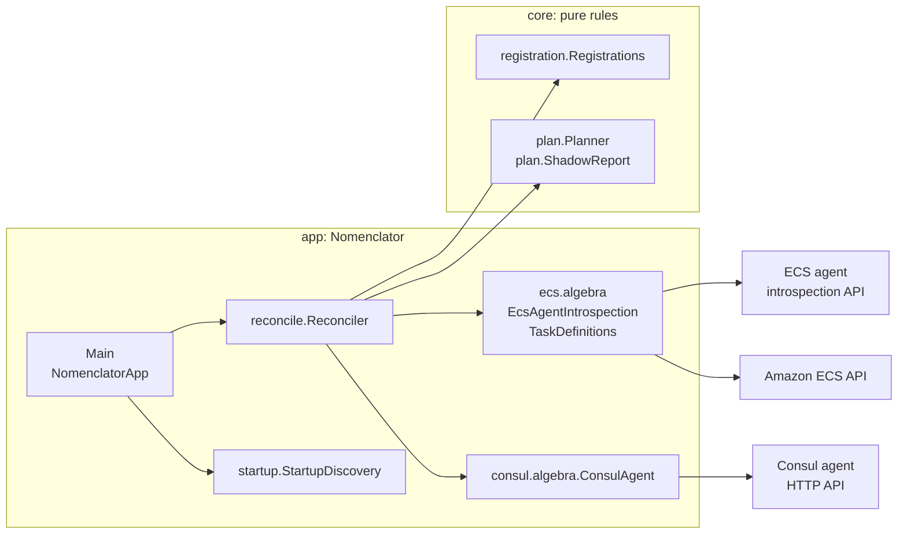
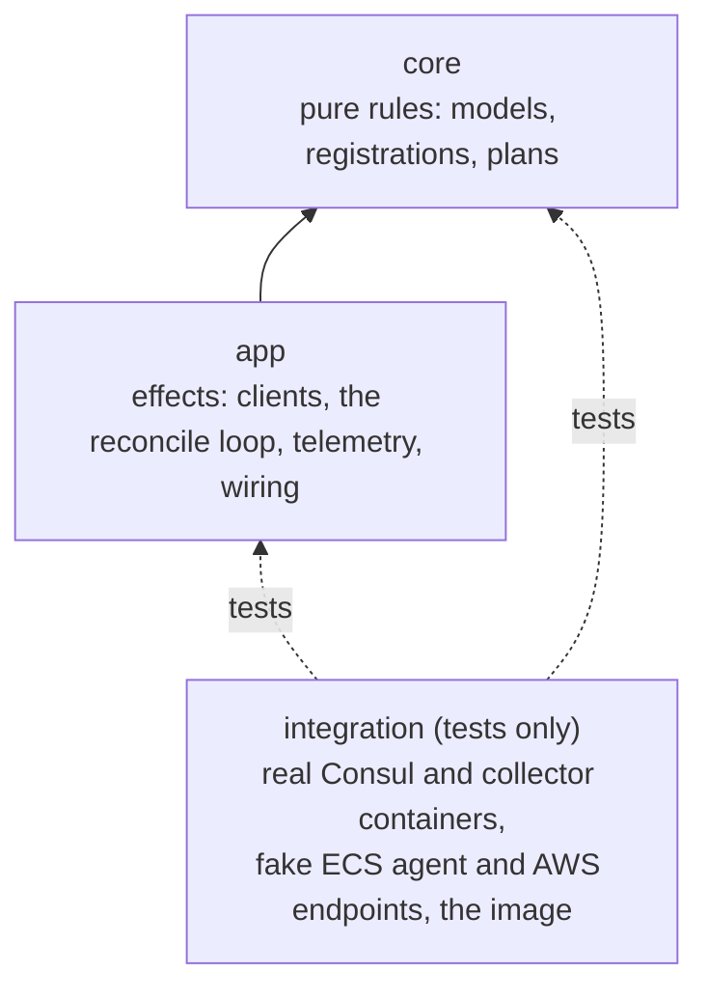
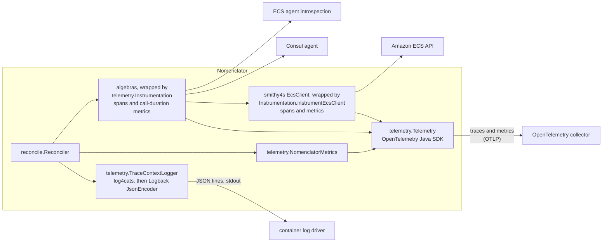

# Nomenclator architecture

How Nomenclator is put together and the conventions its code follows. Read this before changing the code's structure;
change this file when the structure changes.

## What Nomenclator does

Nomenclator is a daemon that keeps a Consul agent's service catalog in step with the containers an Amazon ECS
container instance runs. It polls the ECS agent for the tasks on its host, reads each task definition's registration
settings from the ECS API (once per revision), works out the registrations those tasks call for, and writes the
difference to the local Consul agent. It is shipped as a native-image executable on a distroless base image.



## Modules



- **core** is pure: no effects, no I/O, and no `F[_]` or `IO`-typed code. It depends only on cats and ip4s's address
    types, and its sources import nothing from cats-effect or fs2. It holds the ECS and Consul data models, the rules
    that turn tasks and task-definition settings into registrations (`registration.Registrations`), and the rules that
    diff registrations against what the agent reports (`plan.Planner`, `plan.ShadowReport`, `plan.CheckComparison`). It
    is tested with ScalaCheck generators and a simulated agent, with nothing to start and nothing to wait for.
- **app** is the only module that touches the outside world. `Main` is the `IO` edge; everything below it is written
    against an abstract `F[_]`. It holds the algebras for the two agents and the ECS API, their http4s and smithy4s
    implementations, the reconcile loop, startup discovery, configuration, and telemetry.
- **integration** holds tests only: the reconcile loop and the Consul client against a real Consul agent, the container
    image under the hardening it is meant to run with, and `SmokeEnvironment` for running the app by hand against fakes.
    Its fakes (`FakeEcsAgent`, `FakeAws`) are real HTTP servers, never mocks of our own code.

## Conventions

These are the rules the code follows; new code follows them too.

### Packages: domain first, layer second

Top-level packages are domains (`ecs`, `consul`, `registration`, `plan`, `reconcile`, ...). Inside a domain, the layers
are:

| Layer | Holds | Effects |
| --- | --- | --- |
| `model` | data types, newtypes, their type class instances | none |
| named logic packages (`registration`, `registration.settings`, `plan`) | pure functions over the models | none |
| `algebra` | tagless-final traits (`ConsulAgent[F]`, `EcsAgentIntrospection[F]`, `TaskDefinitions[F]`) and the errors their contracts raise | abstract `F` |
| a package named for a technology (`http4s`, `circe`, `smithy4s`) | an algebra's implementation, or the codecs for a wire format, written against that library | the capabilities the library demands |
| programs and components, at the domain package's root (`reconcile`, `startup`, `telemetry`, `config`) | logic that composes algebras, in `F` with the least capability it needs | abstract `F` |
| `system` | a capability for the outside world (`LocalHostName[F]`) and its live implementation | concrete |

A package earns its own directory when it has a distinct responsibility a reader would look for by name; one-file
packages are fine when the name is what a reader searches for. `consul.circe.ConsulCodecs` holds the Consul agent API's
JSON shapes, shared by the http4s client and by telemetry, which records a registration exactly as it is sent.

### Errors

An exception type's name ends in `Error`. Each algebra or component has one error type. When it can fail in more than
one way, that type is an `enum` whose cases name what happened: `ConsulAgentError`, `ReconcileError`,
`DefinitionLookups.NoFullTurnError`. A type that fails one way is a single case class (`EcsAgentError`, `StartupError`,
`ContainerCredentialsError`). Pure code in `core` reports invalid input as data (`SettingsError`, accumulated in an
`EitherNec`), never by throwing.

### Givens

- An instance whose type class and type are ours, or come from a library **core** already depends on, lives in the
    **companion object of the type**.
- An instance of a type class from a library core doesn't depend on lives app-side in **one clearly named object per
    library**. otel4s-tagless's `ToAnyValue` instances are in `telemetry.TracingValues`: the registration is recorded as
    the JSON it is sent as, and each result is a short summary, never the contents. The instrumented algebras,
    `ConsulAgent` and `EcsAgentIntrospection`, declare `derives AnyValueAspect` and import `TracingValues.given` in the
    file that declares them, so the `derives` clause sees the instances. `TaskDefinitions` derives no aspect: the
    smithy4s ECS client beneath it is instrumented instead. Aspects are derived, never written by hand.
- No private givens in unrelated objects. A codec used by one type stays private in that type's companion.

### Compiler flags

`-experimental` is on for **app** and **integration** only. cats-tagless's `Derive`, which `derives AnyValueAspect`
uses, is experimental, so Scala 3.9 marks every definition in app experimental, and the integration tests, which use
them, need the flag too. **core** compiles without it. Marking just the derived givens `@experimental` would make every
site that summons them experimental as well.

### Effects

Everything that is an effect is suspended in `F`, and code asks for the least powerful capability that works
(`MonadThrow` before `Sync`, `Clock` before `Temporal`). Reads of the outside world go through capabilities:

- **system properties** through `cats.effect.std.SystemProperties[F]`; **environment variables** through
    `cats.effect.std.Env[F]`, read once by `config.NomenclatorConfig`; **the host's name** through
    `system.LocalHostName[F]`.
- `Sync` or `Async` appears only where a library or a blocking call demands it, with a comment naming the reason.
    `LocalHostName.live` needs `Sync` for a blocking Java call, and log4cats-slf4j demands it; ciris, Ember, smithy4s's
    client, and dwolla-otel4s-oteljava demand `Async`.
    The bound goes on the code that needs it, never on the code that uses it.
- The strong bounds meet in one place, `NomenclatorApp.run[F[_]: Async: LiftIO: Env: SystemProperties]`, where the
    capabilities are built and handed down. `Main` fixes `F` to `IO` and is the only place `IO` is named in main code.

## Telemetry



- `telemetry.Telemetry` starts OpenTelemetry on the OpenTelemetry Java SDK through `OtelJavaAtDwolla`, which
    supplies the default exporters and resource attributes; any standard `OTEL_*` variable overrides a default.
- `telemetry.Instrumentation.instrumentAlgebra` runs each algebra call in its own span, recording the inputs and never
    the result, and records the call's duration. `instrumentEcsClient` does the same for the ECS API client, recording
    the request only, because a task definition response holds a container's whole environment.
- `telemetry.NomenclatorMetrics` records how each pass went, what the latest successful one found, and the outcome of
    each task definition lookup.
- `telemetry.TraceContextLogger` adds the current trace and span to each log line, so logs and traces join.
- `http.RedactedJson` decodes response bodies so that a decoding failure never carries any part of the body into logs
    or spans.

## Layout

The main source files, by package and module. Tests sit in the matching test package.

### core

```
com.dwolla.nomenclator.ecs.model            the ECS vocabulary: tasks, ports, names, instance metadata, task definition refs
com.dwolla.nomenclator.consul.model         the Consul vocabulary: names, the agent's state
com.dwolla.nomenclator.registration         HostIdentity, Registration, Registrations (tasks to desired), ServiceIds, ServiceNaming, Desired
com.dwolla.nomenclator.registration.settings  what a task definition's environment and labels say: ServiceSettings, CheckSettings, ContainerSettings, GoDuration, SettingsError
com.dwolla.nomenclator.plan                 Planner (desired vs actual), ShadowReport, CheckComparison, Plan
```

### app

```
com.dwolla.nomenclator
  Main.scala                        the IO edge
  NomenclatorApp.scala              wiring; the one place the strong bounds meet
com.dwolla.nomenclator.config       NomenclatorConfig: the environment, parsed
com.dwolla.nomenclator.consul.algebra     ConsulAgent[F], ConsulAgentError
com.dwolla.nomenclator.consul.http4s      Http4sConsulAgent
com.dwolla.nomenclator.consul.circe       ConsulCodecs: the Consul agent API's JSON shapes
com.dwolla.nomenclator.ecs.algebra        EcsAgentIntrospection[F], TaskDefinitions[F], EcsAgentError, TaskDefinitionMissingError
com.dwolla.nomenclator.ecs.http4s         Http4sEcsAgentIntrospection, IntrospectionCodecs, ContainerCredentials, ContainerCredentialsError
com.dwolla.nomenclator.ecs.smithy4s       EcsClient, CachedTaskDefinitions, ServiceSettingsExtraction, LookupResult
com.dwolla.nomenclator.reconcile    Reconciler, Mode, ReconcileError, FailurePolicy, DefinitionLookups, ChangeLog, Labels, LogContext, Pass reports
com.dwolla.nomenclator.startup      StartupDiscovery, StartupRetry, StartupError
com.dwolla.nomenclator.telemetry    Telemetry, Instrumentation, NomenclatorMetrics, TracingValues, TraceContextLogger, HostResourceAttribute
com.dwolla.nomenclator.system       LocalHostName[F] and its live implementation
com.dwolla.nomenclator.http         RedactedJson
```

### integration

```
com.dwolla.nomenclator.integration  ConsulContainer, FakeEcsAgent, FakeAws, HardenedContainer, SmokeEnvironment,
                                    and the suites: reconcile and Consul against a real agent, image smoke, loopback publishing
```
