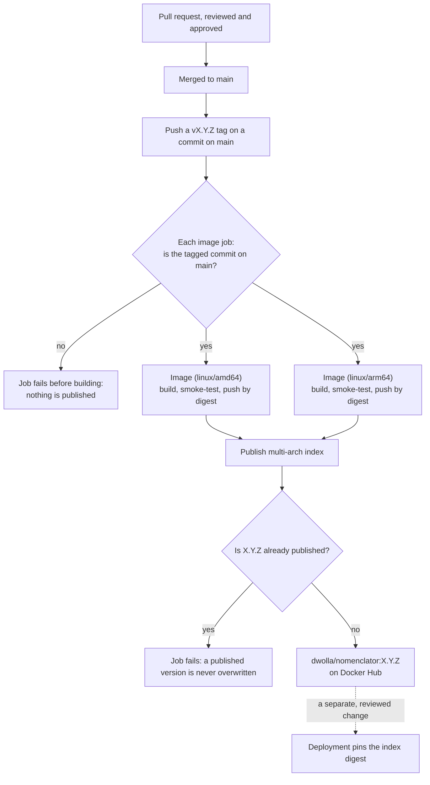
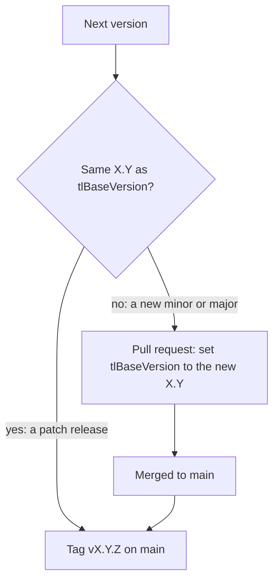
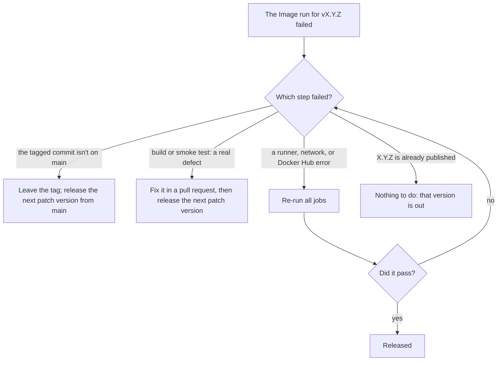

# Releasing Nomenclator

How a version of Nomenclator gets from `main` to Docker Hub, and from there to a deployment. Change this file when
`.github/workflows/image.yml`, the repository's rulesets, or the versioning settings in `build.sbt` change.

## The path of a release

A release is a `vX.Y.Z` git tag on a commit on `main`. Pushing the tag runs `.github/workflows/image.yml`, which
publishes the multi-architecture image `dwolla/nomenclator:X.Y.Z` on Docker Hub. Publishing deploys nothing: a
deployment moves to a release only when the configuration that runs Nomenclator is changed to pin the new image.



What keeps that path honest:

- **Only reviewed code is released.** `main`'s ruleset requires an approved pull request and blocks force pushes, and
  each image job, right after checkout, refuses a tag whose commit isn't on `main`.
- **A release tag never changes.** The repository's `v*` tag ruleset blocks updating, deleting, and force-pushing
  those tags, with no exceptions. Anyone who can push can create one.
- **A version is published whole or not at all.** Each architecture's image is pushed by digest, without a tag. The
  `X.Y.Z` tag appears only when the publish job creates the index, and that job checks that both architectures'
  digests are present first.
- **A published version is never overwritten.** The publish job fails if `dwolla/nomenclator:X.Y.Z` already exists,
  and fails closed if it can't tell.

Pull requests and branch pushes run the same build and smoke tests, and publish nothing.

## Choosing the version

The tag is `vX.Y.Z` (semantic versioning), and the published image is `dwolla/nomenclator:X.Y.Z`. sbt-typelevel's
versioning plugin reads the version from the tag, and `ThisBuild / tlBaseVersion` in `build.sbt` names the `X.Y`
series being developed.



The version has to agree with `tlBaseVersion`, or sbt refuses to load the build:

- **A tag behind it fails the release.** Tagging `v0.0.5` while `tlBaseVersion` is `0.1` makes sbt reject the version,
  so the image jobs fail.
- **A tag ahead of it breaks every later build.** Tagging `v0.2.0` while `tlBaseVersion` is still `0.1` publishes, but
  every untagged build of a later commit on `main` then fails with
  `Your tlBaseVersion 0.1 is behind the latest tag 0.2.0`, `scripts/check` included. That's why the bump is merged
  first.

## Making a release

1. Choose the version (above). For a new minor or major version, merge the `tlBaseVersion` change first.
2. Tag the commit on `main` and push the tag:

   ```shell
   git switch main
   git pull --ff-only
   git tag -a v0.1.0 -m "v0.1.0"
   git push origin v0.1.0
   ```

3. Follow the **Image** workflow's run for the tag in the repository's Actions tab.
4. When it succeeds, take the index digest from the **Publish multi-arch index** job's summary, or ask Docker Hub:

   ```shell
   docker buildx imagetools inspect docker.io/dwolla/nomenclator:0.1.0
   ```

5. Optionally, write release notes as a GitHub release for the existing tag.

Deployments pin the index digest (`dwolla/nomenclator@sha256:...`), not the version tag. Moving a deployment to the new
release is a change to the configuration that runs Nomenclator, reviewed like any other.

## When a release fails

No one can move or delete a release tag, so a release that went wrong is fixed by re-running it or by releasing the
next version, never by retagging.



Re-running is safe: until the publish job creates the index, the run has pushed only untagged per-architecture images.
Re-run all jobs, not only the failed ones, so every step of the release runs again in one attempt.
A tag that will never be published stays in the repository, and its version number is skipped.
